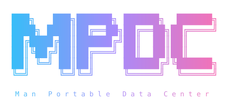

<div align="center">
  
</div>

I MADE THIS TOOL FOR MYSELF BECAUSE I WANTED TO SAVE MONEY ON CLAUDECODE TOKENS. THE FUTURE OF PROGRAMMING DOES NOT RELY ON BIG TECH DATA CENTERS.

Multi-Pool **Programming (`Qwen3` / `Qwen3-Coder` / `DeepSeek-R1`) + Visual & Spatial Intelligence (`Qwen2.5-VL` / `SpatialVLM` / `MASt3R-Depth`)** Local LLM Datacenter stack with a native Rust **Claude-Code-style Coding & Planning TUI (`mpdc-code`)**, **`btop`-style Telemetry TUI (`mpdc-tui`)**, and **Desktop Workbench GUI (`mpdc-gui`)**.

---

## 1. Install (One-Time Setup)

Clone the repository (including the `MPDC-SICA` self-improving agent submodule) and run the global installer:

```bash
git clone --recurse-submodules https://github.com/RA-CAELUM/MPDC.git
cd MPDC
./install.sh
```
*(Or with Nix Flakes directly: `nix profile add .`)*

This compiles and installs four global commands onto your `$PATH` so you can run them inside **any directory**:
- `mpdc-code` (or `mpdc code`) — Interactive Claude-Code-style Coding, Planning & 3D Spatial Swarm TUI
- `mpdc-tui` (or `mpdc top`) — `btop`-style 6-panel Cluster Telemetry & Switchboard TUI
- `mpdc-gui` (or `mpdc gui`) — Native GPU-accelerated Rust `egui` Desktop Telemetry Workbench
- `mpdc` — Unified Datacenter Gateway, Model Pool Manager, and Self-Improvement CLI

---

## 2. How to Run MPDC

### Step A: Start Your Local Inference Engine(s) (`vLLM` / `SGLang` / `llama-server`)
Run one or more local OpenAI-compatible servers for your **Programming Pool** and **Visual/Spatial Pool**:

```bash
# Port 8001: Programming & Reasoning Pool Backbone (Qwen3 / Qwen3-Coder)
vllm serve Qwen/Qwen3-30B-A3B --port 8001 --enable-lora --max-model-len 32768

# Port 8003 (Optional): 2D / Video Vision-Language Model
vllm serve Qwen/Qwen2.5-VL-32B-Instruct --port 8003

# Port 8004 (Optional): 3D Spatial Grounding Model
vllm serve SpatialVLM/Spatial-Grounded-13B --port 8004
```

### Step B: Start the MPDC Datacenter Gateway
In a second terminal, start the MPDC Gateway (streams tokens over SSE to local and remote machines on `:8000`):

```bash
mpdc serve
```

### Step C: Code & Plan in Any Project Folder (`mpdc-code`)
`cd` into **any project folder** on your machine (or another laptop connected over LAN/Tailscale) and launch the interactive Coding & Planning TUI:

```bash
cd ~/your-project
mpdc-code
```

#### How `mpdc-code` works
Every prompt is executed by the **[MPDC-SICA](modules/MPDC-SICA)** agent: a real LLM tool-calling loop (open/write files, run commands, coder / reasoner / spatial sub-agents, overseer) that talks to your models through `mpdc serve`. `mpdc-code` streams SICA's events into the chat pane, then shows the **actual** file changes it made (before/after snapshot diff) and runs an independent check (`cargo test`, `pytest`, `ctest` or `nix flake check`). Full traces are saved under `~/.cache/mpdc/sica-runs/`.

> SICA edits files and runs shell commands **directly in your project directory** (no sandbox). Use it inside a git repo so you can review and revert.

| Env var | Default | Purpose |
| :--- | :--- | :--- |
| `MPDC_GATEWAY_URL` | `http://127.0.0.1:8000` | Gateway that SICA's LLM calls go through |
| `MPDC_SICA_ROOT` | repo `modules/MPDC-SICA` | SICA checkout to run |
| `MPDC_SICA_PYTHON` | `scripts/sica-python.sh` (nix-shell) | Python with SICA's dependencies |
| `MPDC_SICA_TIMEOUT` | `1800` | Seconds before a run is cancelled |
| `LOCAL_LLM_MAX_TOKENS` | `8192` | Output-token cap per call; keep prompt + this below vLLM `--max-model-len` |
| `LOCAL_LLM_CONTINUE_PREFILL` | `1` | Send `continue_final_message` (vLLM/SGLang); set `0` for servers that reject it |

#### `mpdc-code` Keyboard Shortcuts & Slash Commands
| Key / Command | Action |
| :--- | :--- |
| **`Tab` / `Shift+Tab`** | Cycle between **`PLAN MODE (/think)`**, **`CODE & DIFF MODE`**, and **`SPATIAL + CODE SWARM`** |
| **`Ctrl+P`** or `/models` | Open the interactive Model Pool Selector to toggle individual Programming & Spatial/Visual models on/off |
| **`Ctrl+Y`** or `/apply` / `/execute` | Execute the plan produced by the last `/plan` run |
| `/plan <task>` | Run SICA read-only: it inspects the project and returns a numbered plan (no file edits) |
| `/code <task>` | Run SICA autonomously: edit files, build/test, fix, and summarize |
| `/swarm <task>` | Same as `/code`, but SICA is told to use its `spatial_visual_specialist` sub-agent for 3D/visual reasoning |
| `/screen [query]` | Capture a screenshot to `.mpdc_captures/` (not analyzed by a model yet: reference the path in a prompt) |
| `/watch` | Toggle continuous background screen monitoring (`SCREEN WATCH: ON/OFF`) for Spatial AI |
| `/resume` | Restore the previous session (`.mpdc_session.json`) including chat, plan steps, and diffs |
| `/export [file.md]` | Export the full session transcript, plan checklist, and unified file diffs to Markdown |
| `/clear` | Clear the session transcript |
| `/exit` (or `Esc`) | Save session state to `.mpdc_session.json` and exit `mpdc-code` |

#### One-Shot CLI Mode
You can also run multi-agent tasks non-interactively from the command line:

```bash
mpdc code "Fix ROS2 grasp controller Z-axis orientation" \
  --image sim_viewport.png \
  --pointcloud wrist_cam.ply \
  --mode sensor_fusion_loop
```

---

## 3. Monitor & Control Your Datacenter (`mpdc-tui` & `mpdc-gui`)

- **Terminal Monitor (`mpdc-tui`)**:
  ```bash
  mpdc-tui
  ```
  Keys: `j/k` select output computer, `p` pause/resume token stream, `m` cycle swarm coordination mode (`sensor_fusion_loop` / `parallel_ensemble` / `specialist_graph`), `o` export client profile, `s` toggle episodic skill, `t` trigger QLoRA sleep-cycle training, `q` quit.

- **Desktop Workbench GUI (`mpdc-gui`)**:
  ```bash
  mpdc-gui
  ```
  Provides 3 synchronized oscilloscopes, per-node token rate caps, live Programming & Spatial/Visual model pool toggles, Episodic Skill distillation, and QLoRA promotion gate controls.

---

## 4. Manage Model Pools & Self-Improving Pipeline

```bash
# List all active Programming & Visual/Spatial models
mpdc pools

# Register an additional Coding or Spatial/Visual model endpoint
mpdc pools --add-id molmo-spatial-7b --add-name allenai/Molmo-7B-D-0924 --add-category spatial_3d --add-endpoint http://127.0.0.1:8006/v1

# View Online Self-Improvement Scorecard (Pass@1, Iterations-to-Green, Patch Survival Rate, Skill Lift)
mpdc stats

# Export 80% Train (SFT + DPO) and 20% Golden Replay Holdout JSONL datasets
mpdc harvest

# Trigger Tier 3 On-Node QLoRA Training + Gated Evaluation + vLLM LoRA Hot-Swap
mpdc train --now
```

## Submodules
- [`modules/MPDC-SICA`](file:///home/sgk/Projects/MPDC/modules/MPDC-SICA): Self-Improving Coding Agent (`SICA`) pre-configured for local **Qwen3** + **Spatial/Visual Sub-Agents** ([`SpatialVisualAgent`](file:///home/sgk/Projects/MPDC/modules/MPDC-SICA/base_agent/src/agents/implementations/spatial_visual_agent.py)).
